# 🌿 Kişisel Portfolyo & Yönetim Paneli

ASP.NET Core MVC ile geliştirilmiş, **tüm içeriği admin panelinden yönetilebilen** kişisel portfolyo sitesi.
M&Y Yazılım Eğitim Akademi – 12. Dönem Gündüz Grubu, **1. Proje (Portfolyo Case)** kapsamında hazırlanmıştır.

---

## 📸 Ekran Görüntüleri

### 🌐 Site (Kullanıcı Arayüzü)

**Ana Sayfa:** İsim, unvan, tanıtım, profil görseli ve sosyal bağlantılar admin panelinden yönetilir.
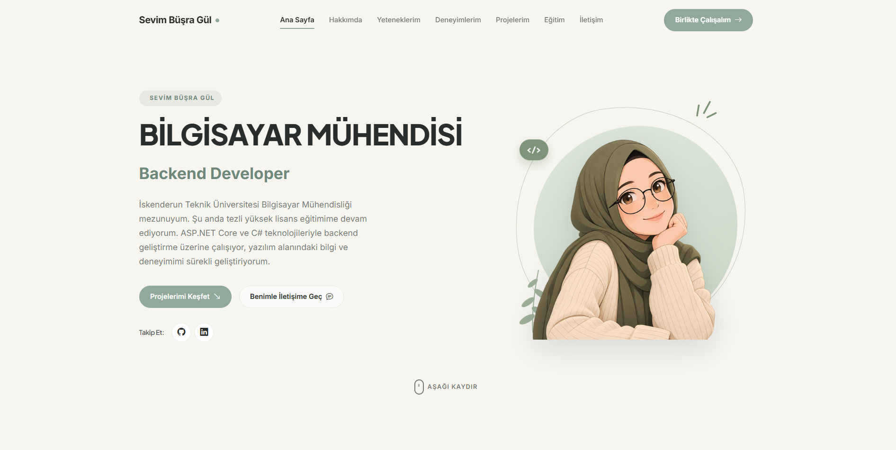

**Beni Tanıyın:** Başlık, paragraflar, görsel ve unvan rozeti admin panelinden gelir.
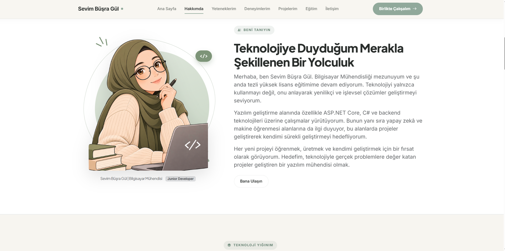

**Yetenekler:** Gruplara ayrılmış yetenekler ve 0-100 seviye çubukları.
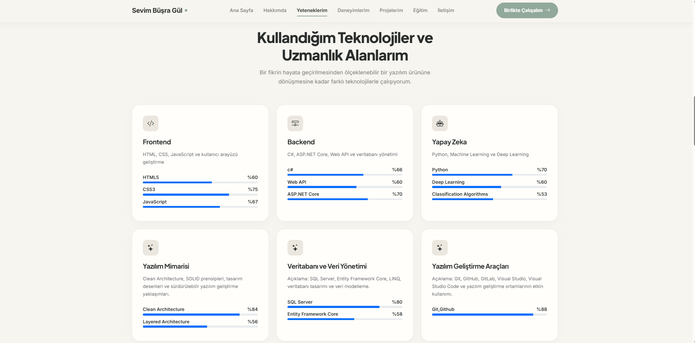

**Deneyimler:** Yalnızca aktif deneyimler zaman çizelgesinde listelenir.


**Projeler:** Kategori filtreleme, en yeni proje en üstte, pasif projeler gizli.
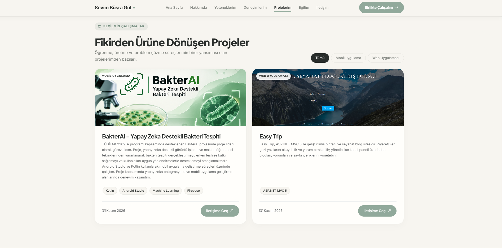

**Eğitim, İletişim ve Footer:** Dinamik eğitim kartları, admin'den gelen iletişim bilgileri ve sayfa yenilenmeden çalışan iletişim formu.
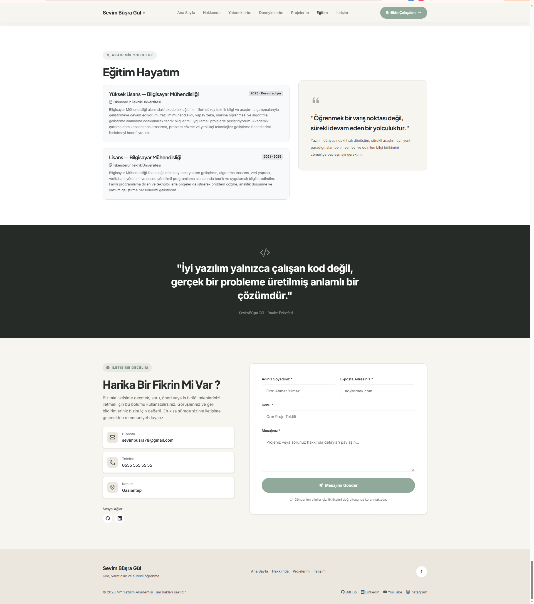

### 🛠️ Admin Paneli

**Dashboard:** İstatistik kartları, kategori özeti (GroupBy), son mesajlar ve hızlı erişim.
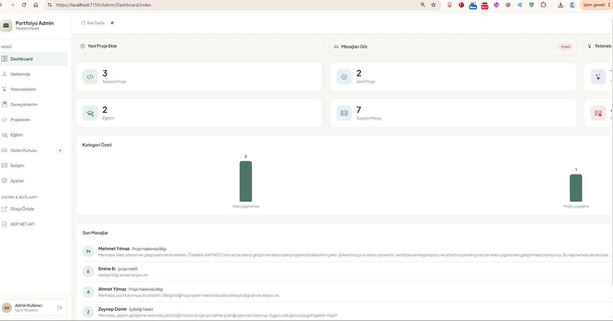

**Gelen Kutusu:** Okunmamış mesajlar vurgulanır, arama, modal detay ve okundu/okunmadı yönetimi.
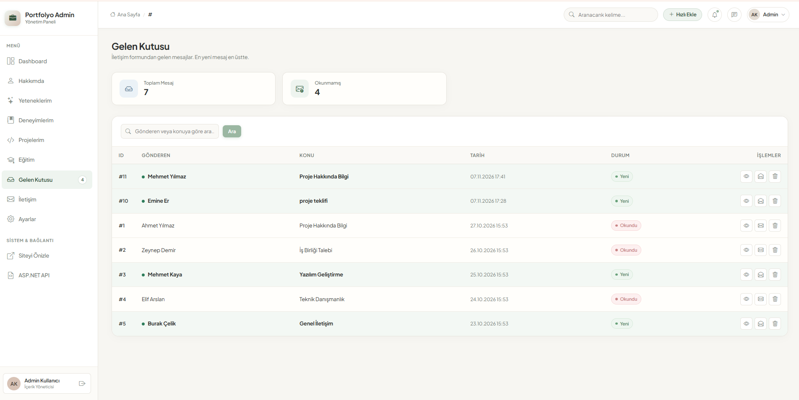

**Projeler:** Görsel, kategori (Include), tarih ve aktif/pasif durumu.
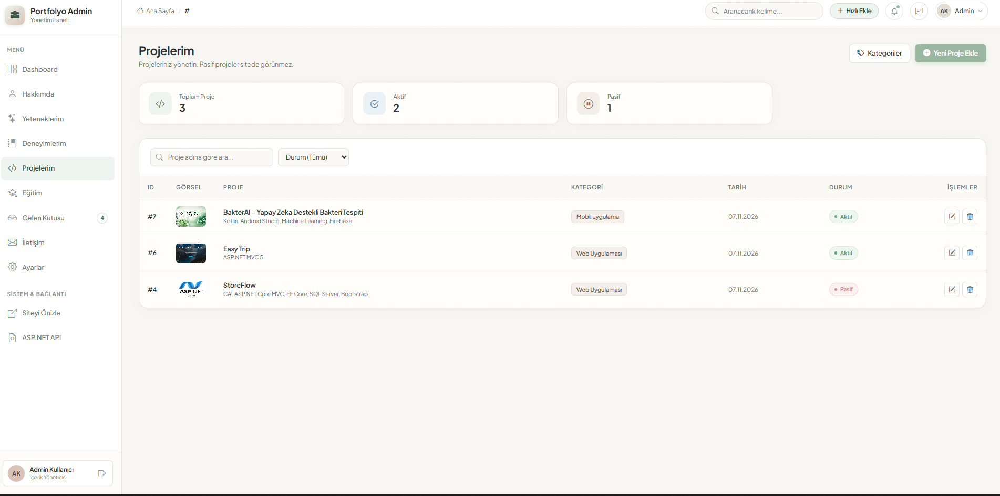

**Yetenekler:** Grup bilgisi ve seviye çubuğuyla listeleme.
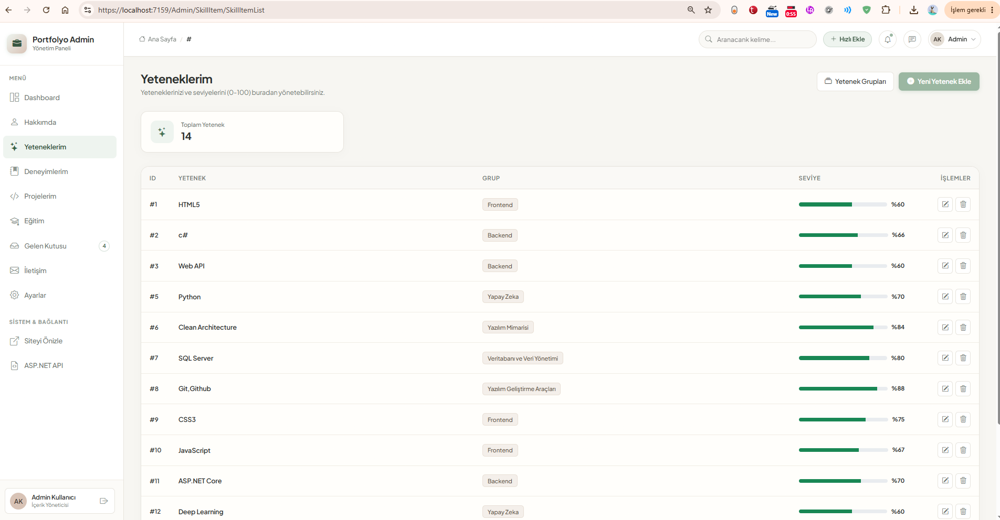

**Deneyimler:** Arama, durum filtresi ve aktif/pasif yönetimi.
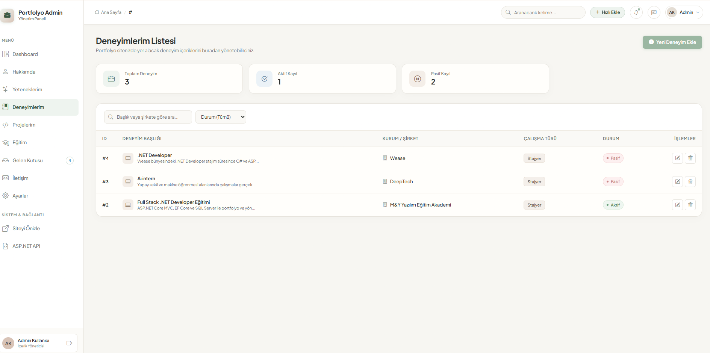

**Deneyim Güncelleme Formu**
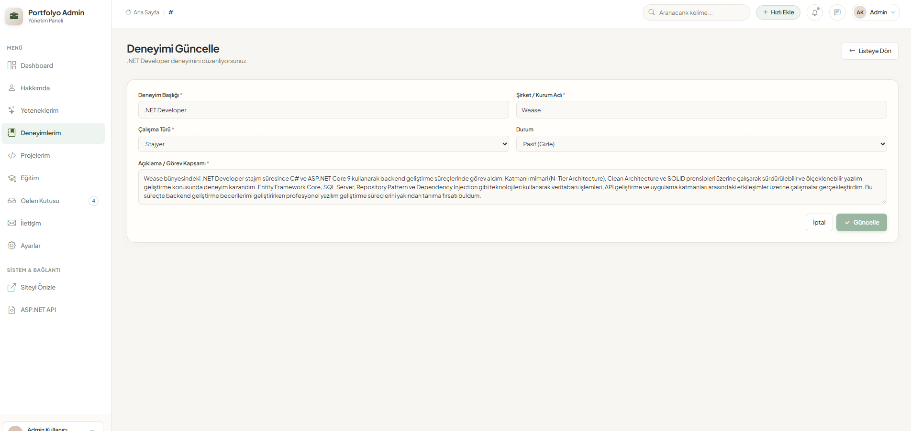

**Ana Sayfa (Hero) Yönetimi:** Görsel yükleme ve öne çıkan bilgiler.
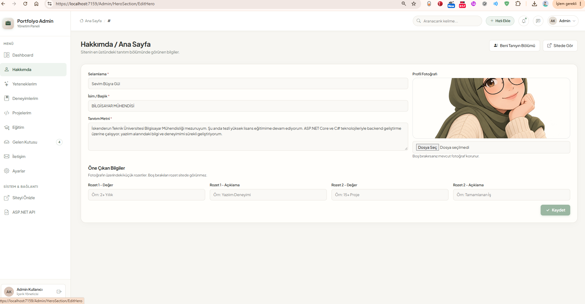

**Beni Tanıyın Yönetimi:** Paragraflar, istatistikler ve özgeçmiş bağlantısı.
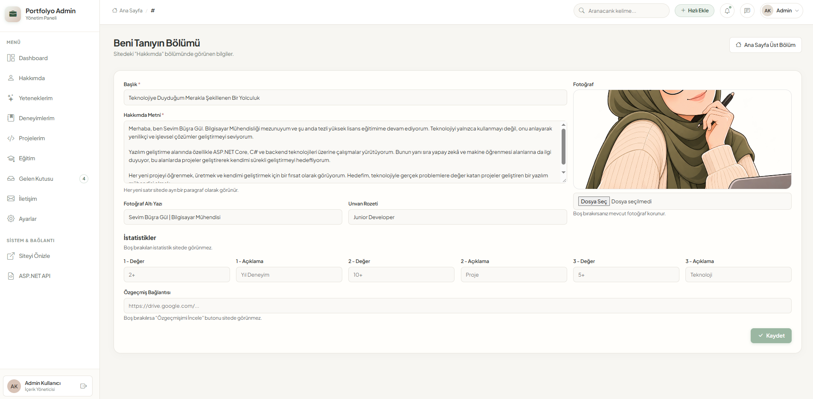

**SweetAlert2 ile Silme Onayı**
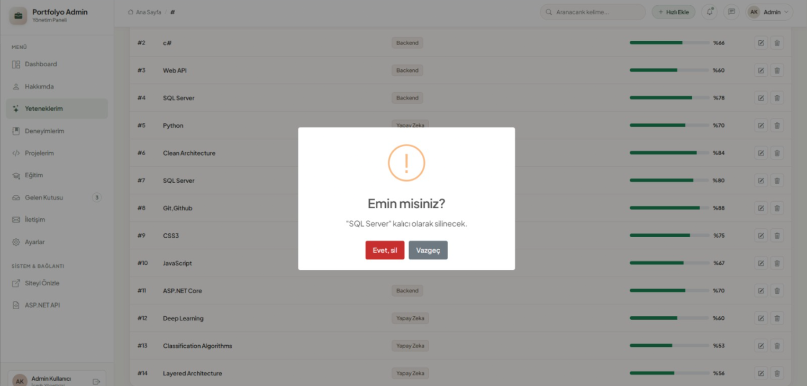

---

## 🛠️ Kullanılan Teknolojiler

| Katman | Teknoloji |
|---|---|
| Backend | ASP.NET Core MVC, C# |
| Veri Erişimi | Entity Framework Core (Code First), LINQ |
| Veritabanı | Microsoft SQL Server |
| Arayüz | Razor View, View Component, Partial View, Bootstrap 5, Bootstrap Icons |
| Etkileşim | Vanilla JavaScript (Fetch API), SweetAlert2, Bootstrap Modal |

---

## ⚙️ Kurulum

1. Repoyu klonlayın:
   ```bash
   git clone https://github.com/SevimBusraGul78/PortfolioProject.git
   ```
2. `Context/PortfolioContext.cs` içindeki bağlantı cümlesini kendi SQL Server bilgilerinize göre düzenleyin:
   ```csharp
   optionsBuilder.UseSqlServer("Server=SUNUCU_ADINIZ;Database=PortfolioDb;Integrated Security=True;TrustServerCertificate=True;");
   ```
3. Visual Studio'da **Package Manager Console**'u açıp veritabanını oluşturun:
   ```
   Update-Database
   ```
4. Projeyi çalıştırın (**F5**).
   - Site: `https://localhost:PORT/`
   - Admin paneli: `https://localhost:PORT/Admin/Dashboard/Index`

---

## 📦 Modüller

Admin panelinde yapılan her değişiklik, sitenin ilgili bölümüne **anında ve dinamik olarak** yansır.

| Modül | Admin Paneli | Site (UI) |
|---|---|---|
| **Ana Sayfa (Hero)** | Selamlama, isim, unvan, tanıtım metni, profil fotoğrafı, öne çıkan rozetler | Üst tanıtım bölümü |
| **Beni Tanıyın** | Başlık, paragraflar, fotoğraf, unvan rozeti, 3 istatistik, özgeçmiş linki | Hakkımda bölümü |
| **Yetenekler** | Yetenek grupları + gruplara bağlı yetenekler (0-100 seviye) | Gruplu kartlar ve seviye çubukları |
| **Deneyimler** | CRUD, çalışma türü, aktif/pasif | Zaman çizelgesi (yalnızca aktifler) |
| **Eğitim** | CRUD, derece, başlangıç/bitiş yılı | Eğitim kartları ("Devam ediyor" desteği) |
| **Projeler** | CRUD, kategori seçimi, görsel yükleme, teknolojiler, aktif/pasif | Kategori filtreli proje kartları (yalnızca aktifler, en yeni üstte) |
| **Proje Kategorileri** | CRUD | Filtre butonları |
| **İletişim & Sosyal Medya** | Tekil iletişim kaydı (e-posta, telefon, konum) + sosyal bağlantı CRUD | İletişim bilgileri, sosyal ikonlar, çalışan iletişim formu |
| **Gelen Kutusu** | Arama, modal ile detay, okundu/okunmadı, silme | İletişim formundan gelen mesajlar |
| **Dashboard** | Dinamik istatistikler ve özet | – |

---

## ✅ Case Gereksinimleri ve Karşılıkları

### 02 · İlişkili Tablolar ve Veri Doğrulama
- **Bire-çok ilişki:** `Category` ➜ `Project` ve `Skill` ➜ `SkillItem`.
  Foreign Key (`CategoryId`, `SkillId`) ve Navigation Property (`Category`, `Projects`, `SkillItems`) kullanıldı.
- **Dropdown:** Proje ve yetenek formlarında kategoriler/gruplar veritabanından `SelectList` ile doldurulup `asp-items` ile bağlandı. Listelerde kategori adı `Include` ile gösteriliyor.
- **Data Annotations:** `[Required]`, `[StringLength]`, `[Range]`, `[EmailAddress]`, `[Url]` kullanıldı. Tüm formlarda sunucu tarafında `ModelState.IsValid` kontrolü ve alan bazlı Türkçe hata mesajları var.
- **Görsel yükleme (`IFormFile`):**
  - Dosya türü kontrolü (jpg, jpeg, png, webp)
  - Boyut sınırı (en fazla 2 MB)
  - `Guid` ile güvenli dosya adı üretimi
  - Veritabanında yalnızca dosya yolu tutuluyor
  - Görsel güncellenince veya kayıt silinince eski dosya sunucudan da siliniyor
  - Bu işlemler tek bir ortak sınıfta toplandı: `Helpers/ImageHelper.cs`

### 03 · Kullanıcı Deneyimi ve İçerik Kontrolü
- Tüm silme işlemlerinde **SweetAlert2** onay penceresi, kayıt işlemlerinde başarı bildirimi (`TempData`).
- Projelerde ve deneyimlerde **Aktif/Pasif** alanı. Pasif kayıtlar admin panelinde yönetilebilir ancak sitede listelenmez.
- Proje listesinde **kategori filtreleme** ve **en yeni proje en üstte** sıralaması.

### 04 · Gelen Kutusu
- Site iletişim formu, sayfa yenilenmeden (**Fetch API**) gönderilir. Doğrulama sunucu tarafında yapılır, hatalar ilgili alanın altında gösterilir.
- Mesajlar **en yeniden eskiye** listelenir, **gönderen veya konuya göre arama** yapılabilir.
- Mesaj detayı **Bootstrap Modal** içinde, sayfa yenilenmeden açılır. Açılan mesaj otomatik olarak **okundu** işaretlenir.
- Okunmamış mesajlar tabloda vurgulanır. **Okunmamış mesaj sayısı** sidebar'da ve Dashboard'da gösterilir.
- Mesaj içeriği düzenlenmez, yalnızca **durumu** (okundu/okunmadı) yönetilir.

### 05 · Dashboard
`DashboardViewModel` ile farklı tablolardaki veriler tek ekranda toplandı:
- **İstatistik kartları:** Toplam/aktif proje, yetenek, deneyim, eğitim, toplam/okunmamış mesaj (`Count`, `Where`)
- **Son 5 mesaj:** Gönderen, konu, tarih ve okunma durumu (`OrderByDescending`, `Take`)
- **Kategori özeti:** Her kategorideki proje sayısı, çubuk grafik ile (`GroupBy`)
- **Son eklenen 3 proje:** Ad, kategori ve aktif/pasif durumu (`Include`)
- **Hızlı erişim:** Yeni Proje Ekle, Mesajları Gör, Yetenek Ekle, Siteyi Görüntüle

---

## ✨ Özgün Katkılar (UX İyileştirmeleri)

- **Canlı görsel önizleme:** Görsel seçildiği anda, kaydetmeden önce formda önizlenir.
- **Seviye kaydırıcısı:** Yetenek seviyesi 0-100 arası bir kaydırıcı ile seçilir, yüzde değeri canlı güncellenir.
- **Sayfa yenilenmeyen iletişim formu:** Kullanıcı sayfanın başına atılmaz. Gönderim sırasında buton kilitlenir, böylece çift gönderim engellenir.
- **Güvenli mesaj görüntüleme:** Modal içeriği `textContent` ile yazılır, mesaj içindeki HTML/script çalıştırılmaz (XSS koruması).
- **Modalda "Yanıtla" butonu:** Gönderene "Re: konu" başlıklı e-posta açar.
- **Tekil içerik yönetimi:** İletişim, Hero ve Hakkımda bölümleri liste yerine tek bir düzenleme formuyla yönetilir.
- **Boş alan gizleme:** Admin'de doldurulmayan rozet, istatistik, telefon veya özgeçmiş linki sitede boş kutu olarak değil, hiç görünmeyecek şekilde ele alınır.
- **Aktif menü vurgusu:** Admin sidebar'ında bulunulan sayfa otomatik olarak vurgulanır.
- **Tekrar eden kodun azaltılması:** Ortak form alanları Partial View'lara (`_EducationForm`, `_SocialMediaForm`), görsel işlemleri `ImageHelper` sınıfına taşındı.
- **Özgün hero tasarımı:** Profil görseli; CSS ile çizilmiş organik şekil, çizgi halka, SVG süslemeler ve hafif animasyonlarla sunulur.

---

## 🐞 Mevcut Kodda Yapılan Düzeltmeler

- `MessageController.DeleteMessage` içinde eksik olan `SaveChanges()` eklendi (silme veritabanına yansımıyordu).
- `Skill` ve `Contact` entity'lerinde `int` tanımlanmış metin alanları (`Title`, `Description`, `Email` vb.) `string` olarak düzeltildi.
- Var olmayan bir sayfaya giden "Mesajı Aç" bağlantısı modal ile değiştirildi.
- Uygulamanın açılış sayfası şablondaki varsayılan `Home` yerine portfolyo sayfasına (`Default`) yönlendirildi.

---

## 📁 Proje Yapısı

```
MyAcademy_PortfolioProject
├── Areas/Admin
│   ├── Controllers        → Admin CRUD işlemleri
│   ├── Models             → DashboardViewModel
│   ├── ViewComponents     → Admin layout parçaları (sidebar, navbar...)
│   └── Views              → Admin sayfaları
├── Context                → PortfolioContext (DbContext)
├── Controllers            → DefaultController (site + iletişim formu)
├── Entites                → Veritabanı tabloları
├── Helpers                → ImageHelper (görsel yükleme/silme)
├── Migrations             → EF Core Code First migration'ları
├── ViewComponents         → Site bölümleri (Hero, Hakkımda, Projeler...)
├── Views                  → Site sayfaları ve component görünümleri
└── wwwroot/images         → Yüklenen görseller
```

---

---|
|  |  |
|  |  |

---

**Geliştiren:** Sevim Büşra Gül
